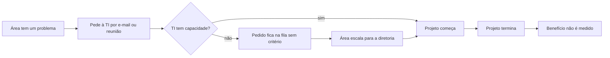
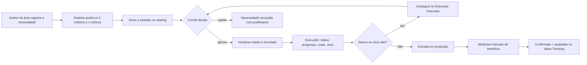
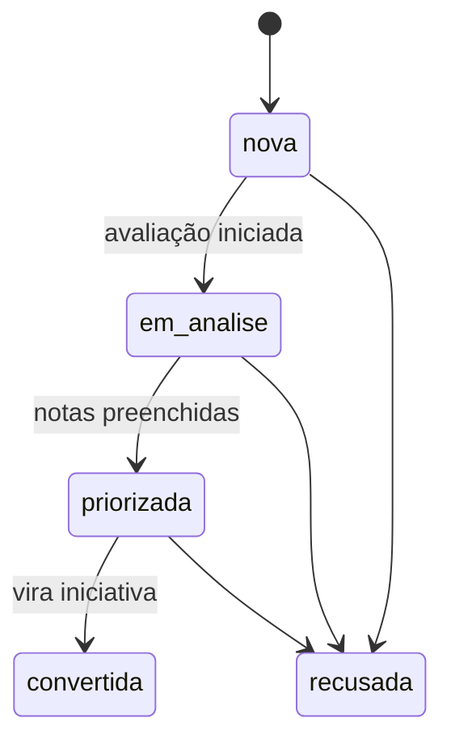
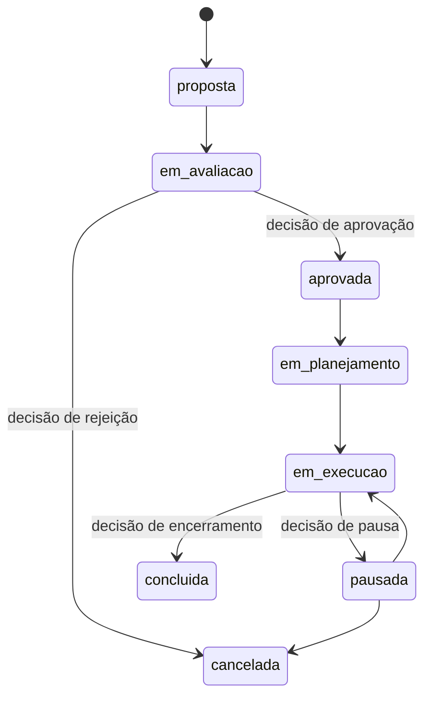

# 3. Processos

## Processo atual típico (AS-IS)

Problemas: critério implícito, decisões sem registro, nenhuma verificação de valor.

## Processo com o NEXUS (TO-BE)

Toda seta que muda dados gera um registro na trilha de auditoria.

## Ciclo de vida da necessidade

## Ciclo de vida da iniciativa

