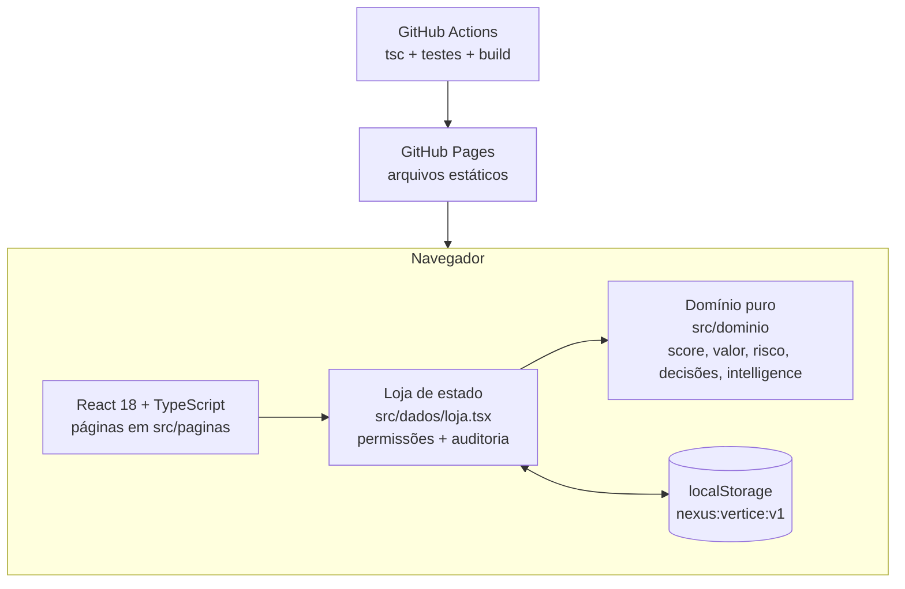
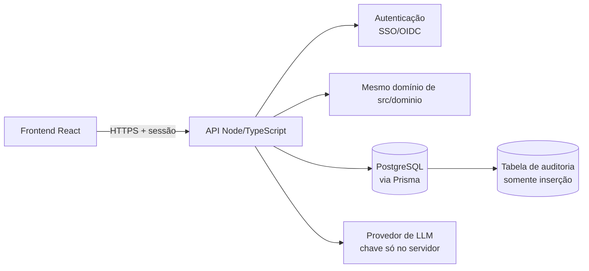

# 8. Arquitetura

## Fase 1 — demonstração (o que está publicado)

**Princípio:** toda regra de negócio fica em `src/dominio`, em funções puras sem React nem armazenamento. Assim, ela é testada de forma isolada e pode ir para o servidor na fase 2 sem reescrita.

| Pasta | Responsabilidade |
|---|---|
| `src/dominio` | Tipos, regras de negócio, cálculo de score, valor, risco, decisões, CSV e o motor do Intelligence |
| `src/dados` | Dados de demonstração (Vértice Group) e a loja de estado (persistência, permissões, auditoria) |
| `src/paginas` | Uma tela por módulo |
| `src/componentes` | Componentes visuais reutilizáveis (KPIs, selos, modal, barras) |

### NEXUS Intelligence na fase 1

Roda **sem IA generativa**. Um motor de regras (`src/dominio/intelligence.ts`) identifica a intenção da pergunta (prioridades, riscos, orçamento, valor, decisões, área ou código) e monta a resposta só com os dados cadastrados. Quando não reconhece a pergunta ou não há dados, diz isso. A tela informa esse modo ao usuário.

## Fase 2 — produção (planejada)

- O LLM recebe apenas os dados que o usuário pode ver e é instruído a responder só com eles; a resposta cita as fontes.
- A chave do provedor fica em variável de ambiente no servidor. **Nunca** no frontend.
- Toda permissão é checada na API, não só na interface.
- Todas as tabelas têm `organizacaoId`, e as consultas filtram por ele (multiempresa).

O esquema planejado está em [`prisma/schema.prisma`](../prisma/schema.prisma) e no [modelo de dados](09-modelo-de-dados.md).

## Qualidade

- `npm test`: testes de domínio com Vitest.
- `npm run build`: checagem de tipos (`tsc -b`) e build.
- O workflow `.github/workflows/deploy.yml` roda os dois antes de publicar.
- Acessibilidade conferida com axe-core em todas as telas durante o desenvolvimento.
