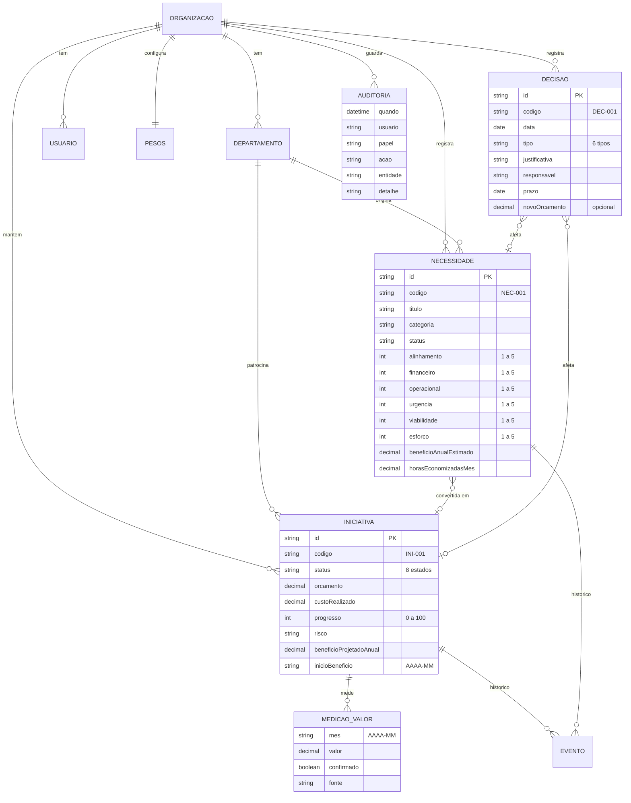

# 9. Modelo de dados

Na fase 1, o modelo vive em `src/dominio/tipos.ts` e é guardado como um único documento JSON no navegador. O diagrama abaixo é o modelo relacional planejado para a fase 2 (ver [`prisma/schema.prisma`](../prisma/schema.prisma)).

## Observações

- O score **não** é gravado: é calculado a partir das notas e dos pesos vigentes, para nunca ficar desatualizado quando os pesos mudam.
- Os códigos (NEC/INI/DEC) são sequenciais por organização.
- A auditoria é somente inserção.
